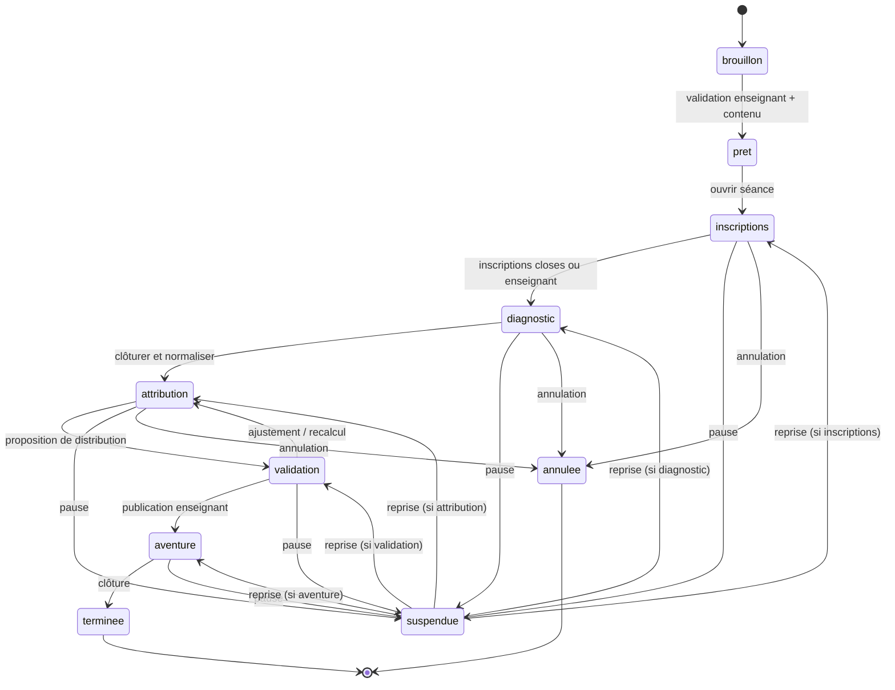

# 02 — Parcours de la capsule et machine à états

## Préparation de l'enseignant

1. Choisir une capsule versionnée, la cohorte, la plage d'âge, le nombre de places et les rôles disponibles.
2. Vérifier contenus, accessibilité, consentements/permissions et état éditorial des Kristals.
3. Choisir le mode d'attribution (`tiers_choix` ou `attribution_guidee`), les aménagements, les contraintes relationnelles utiles à une mission, et la date d'expiration.
4. Ouvrir la séance et afficher un **code de jonction à durée limitée**. Aucun nom sensible n'apparaît à l'écran projeté.

## Parcours de l'élève

1. Ouvrir l’Entry Door de KOMPOSE dans le navigateur du Chromebook; rejoindre avec code + méthode d'identification autorisée par l'école.
2. Découvrir les fiches de rôles accessibles (compétences sollicitées, objectifs, responsabilités, sans difficulté stigmatisante).
3. Passer le diagnostic avec les aménagements définis; reprise possible après déconnexion.
4. Attendre la clôture; ne voir **ni note brute ni rang des autres**.
5. Si son tour est ouvert dans la première tranche : choisir parmi les rôles encore disponibles; sinon recevoir une proposition d'attribution. L'enseignant peut confirmer/adapter la distribution avant publication.
6. Découvrir ses missions; acquérir, solliciter ou protéger l'accès à un Kristal dans le cadre du scénario.
7. Envoyer une demande au gardien ou recevoir un jeton d'accès; poser des **questions guidées** au lecteur documentaire.
8. Comparer les preuves, documenter les sources et accomplir la mission; clôturer la séance.

## Machine à états

## Engagements UX

- Le système montre à l'élève **ce qu'il peut faire maintenant**, pas des statuts techniques.
- La mécanique du « premier tiers » doit être expliquée sans afficher les scores des autres; proposition d'un **mode sans classement** si le contexte pédagogique le demande.
- Un enfant sans connexion ou sans test exploitable obtient un parcours accessible via rattrapage ou placement enseignant, jamais une exclusion silencieuse.
- Un gardien absent entraîne la réattribution ou l'accès de secours, sans bloquer la capsule.

## Cas d'échec prioritaires

| Situation | Comportement attendu |
|---|---|
| Code de capsule expiré | Message neutre, enseignant peut régénérer |
| Inscription doublonnée | Réutiliser l'identité de séance; aucune nouvelle place |
| Test interrompu | Sauvegarder la progression; autoriser une reprise |
| Diagnostic incomparable | Suspendre **le classement**; recourir au mode guidé |
| Rôle devenu indisponible | Retirer de la sélection et réévaluer |
| Contrainte insoluble | Proposer des relaxations **seulement sur règles souples**; bloquer si risque de sécurité |
| Gardien déconnecté | Déléguer un gardien de secours ou différer l'accès |
| Contenu non validé | Refus de publication, mode démo explicite uniquement |
