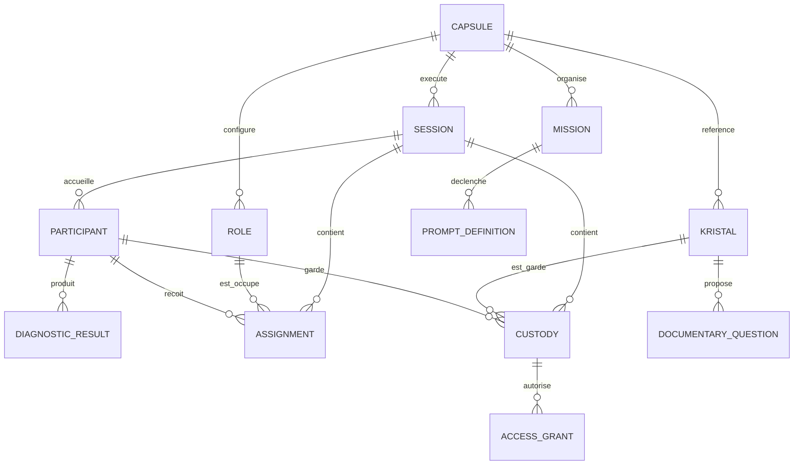

# 03 — Modèle de domaine

> **Attention : modèle conceptuel / simulation locale.** `Session`, `MissionProgress`, `Phase` et `Event` dans ce document ne désignent pas les agrégats opérationnels `Case`/`Task`/`Signal` d’Orgo. Pour Tandem, **Orgo est propriétaire des transitions et autorisations réelles** (voir [ADR 0008](adr/0008-tandem-orgo-operational-authority.md)).

## Concepts

| Entité | Description | Responsable futur pressenti |
|---|---|---|
| `Capsule` | scénario, options, références aux rôles/Kristals/missions | catalogue pédagogique |
| `Session` | cycle de vie de référence / simulation locale | KOMPOSE pour simulation; Orgo pour exécution réelle Tandem |
| `Participant` | identifiant pseudonyme propre à la séance | identité/séances |
| `Role` | responsabilités, capacité, interactions, missions associées | moteur de rôles |
| `DiagnosticBlueprint` | dimensions/questions/aménagements, version | évaluation |
| `DiagnosticResult` | mesures comparables, limites et adaptations; **privé** | évaluation |
| `TeacherConstraint` | obligations ou préférences sous contrôle enseignant; **privé** | console pédagogique |
| `Assignment` | rôle attribué, justification non stigmatisante, version | attribution |
| `Kristal` | document structuré et immuable par version, perspective, sources, questions | contenu |
| `Custody` | garde temporaire d'un Kristal par participant; **différente de la propriété du contenu** | missions |
| `AccessGrant` | autorisation temporaire de lecture | permissions |
| `PromptDefinition` | message scénarisé déclenché par événement et destinataire autorisé | moteur de missions |
| `Event` | fait de domaine horodaté et traçable | orchestration/événements |
| `Phase` | étape synchronisée du groupe, prérequis et alternatives | coordination |
| `MissionProgress` | état minimal individuel de mission | progression |
| `IntegrationManifest` | capabilities d’un client et frontière d’accès aux données | adaptateur client |

## Relations

## Invariants d'identité et de conservation

- Tous les identifiants sont opaques; les identifiants de participants sont spécifiques à la séance. Ne pas utiliser les noms d'élèves dans les événements exportés.
- `Kristal.id + version` désigne une **version éditoriale**; `Custody` ou `AccessGrant` ne modifie jamais son contenu.
- `Assignment` et `Custody` sont historisés : éviter de réécrire silencieusement les attributions.
- Dans un contexte à capacité unitaire : un participant a au plus un rôle actif, chaque rôle au plus une attribution active; variantes explicites possibles.
- Les contraintes enseignant ne transitent pas dans les API publiques des élèves.

## États du Kristal

- `draft` : auteur en cours; non lisible par élève.
- `in_review` : contrôle éditorial; non lisible par élève.
- `published` : sources, permissions et revue approuvées, lisible si autorisé.
- `retired` : plus accessible en nouvelle capsule; copie versionnée conservée selon politique.
- `demo` : fictif, uniquement en environnement de démonstration.

## Séparation majeure

**`Perspective` n'est pas synonyme de vérité.** Un document décrit son émetteur, son contexte, les limites et les sources; plusieurs Kristals peuvent couvrir les mêmes faits sans présupposer leur équivalence. **`Custody` n'est pas synonyme de connaissance supérieure.** Le gardien anime le parcours, mais le lecteur sert toujours le texte validé.
