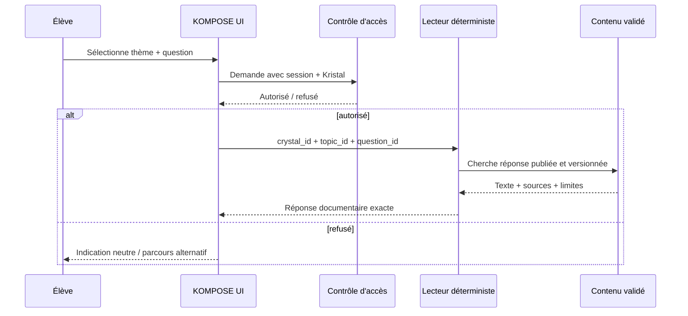

# 06 — Moteur documentaire et moteur d'événements (sans IA)

## Principe

Le lecteur du Kristal est **déterministe** : ni LLM, ni modèle conversationnel, ni interpolation libre des faits. Chaque question est sélectionnée depuis une taxonomie et résolue par un identifiant, avec validation de l'accès.

## Pipeline cible

1. **Autoriser** la séance, l'identité pseudonyme, le droit de lire, le contexte de mission.
2. **Résoudre** un identifiant de question parmi ceux publiés pour cette version.
3. **Retourner** `answer`, `source_refs`, `limitations`, `version` exactement enregistrés.
4. **Journaliser** la consultation sans conserver le contenu de réponses personnelles ou des déductions intimes.
5. **Émettre** au besoin `kristal.question_consultee` (événement minimal), déclenchant des prompts scénarisés idempotents.

## Modèle de prompt

`PromptDefinition` contient : événement déclencheur, conditions simples, cible (`demandeur`, `gardien`, `enseignant`, `groupe`), texte rédigé, identifiant de déduplication, dates/état de mission et action proposée. Aucun message personnalisé sur la base de scores privés ou d'aversions entre enfants.

Exemples de déclencheurs :
- `session.roles_publies` → « Découvre ta première mission »;
- `kristal.garde_attribuee` → « Tu veilles sur cet indice; accompagne les chercheurs »;
- `kristal.acces_demande` → « Une personne cherche l'archive »;
- `kristal.acces_accorde` → « Le lecteur documentaire est disponible »;
- `kristal.question_consultee` → « Compare cette preuve à une autre source »;
- `mission.validee` → « La prochaine étape est ouverte ».

## Questions non couvertes

Si l'interface permet ultérieurement une saisie textuelle, elle peut uniquement faire une recherche **locale déterministe** sur des libellés prédéfinis, afficher une suggestion de question, puis exiger une **sélection explicite**; aucun texte libre ne doit être envoyé à un modèle génératif. Le périmètre de référence se limite aux choix prédéfinis.

## Sécurité des événements

Déduplication (`event_id` + `prompt_id`), reprise sur incident, version du contenu épinglée, horodatages serveur, ordre causal si nécessaire. Sur changement de garde, invalider les jetons concernés sans révoquer rétroactivement les consultations déjà autorisées.

## Code démonstrateur

`src/kompose/reader.py` montre la résolution exacte; `src/kompose/events.py` montre la sélection déterministe de prompts. Ce **n'est pas** un service HTTP sécurisé : la validation des droits est spécifiée dans les contrats et doit être implémentée par KOMPOSE.
