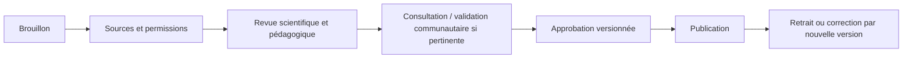

# 10 — Gouvernance des savoirs et perspectives historiques

## Source vérifiée : critère opérationnel

Un Kristal « publié » doit disposer, pour **chaque réponse factuelle**, d'au moins une source identifiée et vérifiable, d'un contrôle éditorial humain daté, d'une description de la portée/limites et des autorisations nécessaires. « Vérifié » décrit un **processus**, pas une prétention d'infaillibilité.

## Fiche éditoriale minimale

- Identité de la source (auteur/institution/communauté, titre, date, référence ou URL stable, format).
- Statut : primaire/secondaire/oral, provenance, traduction, contexte de production et limitations.
- Perspective : **attribution précise**; ne jamais utiliser simplement « point de vue des Autochtones » comme s'il s'agissait d'un groupe unique.
- Autorisations : licence, permission de citer/reproduire, protocole culturel pertinent, éventuelles restrictions de circulation ou de consultation.
- Revue : responsable, date, décision (`approved` ou `rejected`), version auditée.
- Présentation à l'élève : langage adapté, outils pour distinguer faits, interprétations et zones inconnues.

## Récit colonial et autochtone

Une capsule pourrait donner accès à des archives coloniales et à des savoirs documentés d'une ou plusieurs **nations spécifiques**. Les types de source, conditions de transmission et asymétries historiques doivent apparaître clairement. L'objectif n'est pas de simuler une fausse symétrie ni de faire décider aux élèves si un témoignage communautaire « gagne » contre une archive administrative. Un contenu attribué à une nation doit être validé dans les conditions convenues avec les détenteurs des droits et du savoir.

## Workflow de publication

## Gestion d'une correction historique

Si une réponse est erronée : mettre la version en retrait, bloquer l'ouverture de nouvelles sessions, informer les enseignants ayant utilisé la version selon les politiques applicables, publier la correction dans une **nouvelle version** et documenter les impacts pédagogiques.

## Démonstrations et vrais savoirs

Les données `examples/` utilisent des questions **méthodologiques fictives**. Aucune personne historique, nation, source ou témoignage inventé n'y est présenté comme un fait vérifié. Leur état éditorial `demo` interdit le mode production.
