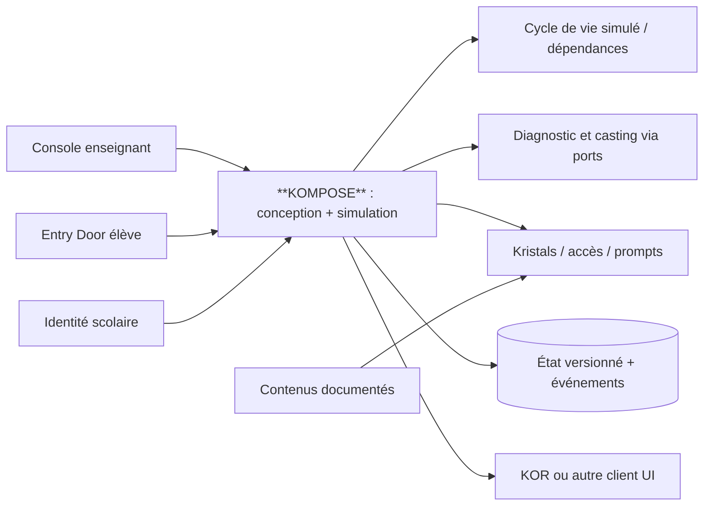

# KOMPOSE

**Concepteur, validateur et simulateur de capsules pédagogiques; Orgo est l’unique orchestrateur opérationnel Tandem.**

**Version :** `0.2.0` · **Langue :** français · **Statut :** dépôt autonome de référence technique, avec simulation exécutable, **pas un produit scolaire prêt à déployer**.

> **KOMPOSE et KOR sont deux applications distinctes.** KOMPOSE peut piloter la progression d'une capsule et fournir des événements à l'interface KOR via un adaptateur facultatif. L'architecture reste indépendante des clients et du fournisseur d'identité scolaire.

## Wiki de référence

Le [wiki KOMPOSE](../Kompose.wiki/Home.md) propose un parcours lisible pour les enseignants, concepteurs et intégrateurs, avec [navigation complète](../Kompose.wiki/_Sidebar.md) et [instructions de publication GitHub Wiki](../Kompose.wiki/README-WIKI-SOURCE.md). Ce wiki est préparé pour une future publication ; **il n’est pas encore en ligne**. Les spécifications normatives restent dans `contracts/` et `docs/`.

## Ce que fait KOMPOSE

Le professeur ouvre une **capsule** et les élèves la rejoignent avec un code temporaire et une identité scolaire autorisée depuis leur Chromebook/tablette. Ils découvrent les rôles et passent un diagnostic adapté. Selon la politique de la séance, les élèves d'un premier groupe (ex. `ceil(n/3)`, uniquement si les scores sont comparables) choisissent leur rôle; les autres reçoivent une **proposition** d'attribution selon contraintes et préférences, sous approbation enseignante. Le simulateur de référence décrit ensuite missions, événements, phases communes et **Kristals** : des savoirs documentaires édités, sourcés, détenus temporairement par un gardien et lus par questions préétablies **sans IA générative**. L'enseignant conserve la possibilité d'intervenir, suspendre, reprendre et clôturer l'expérience.

## Les 9 blocs fonctionnels

| Bloc | Responsabilité | Document |
|---|---|---|
| 1. Entry Door | Accueil, code de capsule, authentification externe, reprise | [15](docs/15-entry-door.md) |
| 2. Diagnostic | Évaluation adaptative et contrôles d'équité | [04](docs/04-diagnostic-et-attribution.md) |
| 3. Casting | Choix / attribution adaptée sous contrôle enseignant | [04](docs/04-diagnostic-et-attribution.md) |
| 4. Coordination | Cycle de vie, événements, dépendances et phases | [16](docs/16-orchestration-et-dependances.md) |
| 5. Kristals | Savoirs vérifiés, questions guidées, gardiens | [05](docs/05-kristals-et-connaissances.md) |
| 6. Interactions | Quêtes coopératives, rencontres et transmission | [14](docs/14-recette-narrative.md) |
| 7. Adaptation | Aides, parcours alternatifs, rythme et accessibilité | [07](docs/07-interfaces.md) |
| 8. Supervision | Console, affinités/aversions privées, interventions | [17](docs/17-supervision-et-continuite.md) |
| 9. Clôture | Bilan, restauration d'une séance, conservation minimale | [17](docs/17-supervision-et-continuite.md) |

## Démarrage immédiat (Python 3.10+, sans dépendances)

```bash
# Depuis la racine du dépôt :
PYTHONPATH=src python3 -m unittest discover -s tests -v
PYTHONPATH=src python3 -m kompose.cli validate examples/capsule-rivieres
PYTHONPATH=src python3 -m kompose.cli demo-flow examples/capsule-rivieres
PYTHONPATH=src python3 -m kompose.cli quota 20
PYTHONPATH=src python3 -m kompose.cli ready-missions examples/capsule-rivieres/missions.json
PYTHONPATH=src python3 -m kompose.cli read examples/capsule-rivieres/kristals.json KR-ARCHIVES TERRITOIRE OCCUPANTS --demo
PYTHONPATH=src python3 -m kompose.cli trigger examples/capsule-rivieres/prompts.json kristal.acces_accorde --audience demandeur --demo
```

Pour installer en développement avec validateurs de schéma facultatifs : `python -m pip install -e '.[dev]'`, puis `python -m unittest discover -s tests -v`.

**Important :** tous les participants, textes et territoires de la capsule de démonstration sont fictifs. `--demo` autorise seulement ces contenus dans un test local. Le lecteur refusera de les faire passer pour du contenu historique approuvé.

## Architecture



Le code livré contient un **modèle de règles pur** et des validations, pas de stockage réseau ni d'interface hébergée. Chaque port extérieur doit être réalisé avant utilisation en contexte scolaire.

## Arborescence

```text
kompose/
├── README.md
├── ../Kompose.wiki/            # Dépôt wiki voisin, non écrit par KOMPOSE
├── docs/                       # conception, sécurité, ADR, architecture et intégration
│   ├── 00-identite-et-positionnement.md
│   ├── 01-vision-et-perimetre.md ... 20-plan-d-integration.md
│   ├── adr/
│   └── diagrammes/
├── contracts/
│   ├── openapi.yaml             # API illustrative non hébergée
│   ├── events.md                # catalogue des événements
│   └── schemas/                # JSON Schemas v2020-12
├── examples/
│   ├── capsule-rivieres/       # 20 rôles, 2 Kristals, 4 missions, phases, prompts
│   └── integrations/           # adaptateur KOR fictif facultatif
├── src/kompose/               # lecteur documentaire, entrée, machine à états,
│                              # coordination, attribution de référence, validations et CLI
├── tests/                     # tests de comportement et de contrat
└── .github/workflows/check.yml
```

## Lire en priorité

- [Identité et frontières produit](docs/00-identite-et-positionnement.md)
- [Machine à états du parcours](docs/02-parcours.md)
- [Modèle de domaine](docs/03-domaine.md)
- [Architecture indépendante et ports/adaptateurs](docs/18-architecture-ports-adapters.md)
- [Contrats, confidentialité et événements](docs/19-contrats-de-donnees.md)
- [Scénarios d'acceptation](docs/11-scenarios-et-tests.md)
- [Plan d'intégration et définition de « prêt pour une classe »](docs/20-plan-d-integration.md)
- [Catalogue complet des documents](docs/INDEX.md)

## Invariants à préserver lors des intégrations et absorptions

1. Le **code de capsule** n'est jamais une authentification scolaire suffisante.
2. Le rôle et le diagnostic n'étiquettent pas durablement la valeur des enfants; aucun classement public.
3. **Contraintes de sécurité et droits d'accès** avant optimisation ou préférences.
4. Les relations confidentielles restent séparées des événements publiés aux élèves et aux clients narratifs.
5. Le Kristal et son gardien sont **deux objets différents**; les contenus restent versionnés, sourcés, et gouvernés éditorialement.
6. Le lecteur ne génère pas de connaissances : **questions/réponses prévalidées**, sinon réponse indisponible.
7. Les perspectives historiques sont **situées**, avec attribution des sources et sans fausse symétrie des preuves; partenariat avec les communautés concernées selon le contenu.
8. L'enseignant peut contrôler, corriger, suspendre et reprendre; les modifications sont auditables.
9. Missions et phases n'ont pas de dépendance circulaire; les absences ont des solutions de secours.
10. Les contrats sont versionnés et testés avant toute réimplantation par une application cliente ou un service.

## Tandem P1 — frontière avec Orgo

Les modèles `lifecycle` et `coordination` servent aux **tests et simulations locales**. Ils ne doivent pas faire avancer des missions réelles quand Orgo est présent. La commande `verify-ekole-preview` valide un export strictement synthétique du format Ekole P1, sans API, identité ni droit enfant. Voir [ADR 0008](docs/adr/0008-tandem-orgo-operational-authority.md) et [le contrat P1](docs/TANDEM_P1_ORGO_EKOLE_ALIGNMENT.md).

## Fait / à faire

**Livré :** dépôt Git versionné, contrats OpenAPI/JSON Schema, documentation et ADR, démonstrateur CLI à événements et réponses déterministes, contrôles de publication des Kristals, cohérence de capsule fictive et tests automatiques.

**À faire pour la production :** véritable interface web, authentification SSO scolaire, stockage transactionnel, moteur adaptatif validé, solveur de contraintes complet, permissions/rate-limits, revue historique des contenus, accessibilité testée, audits, exploitation et conformité locales. La simulation bypass explicitement les validations réelles avec **des valeurs fictives**.

Aucune licence de redistribution n'a encore été arrêtée : [LICENSE-TO-DECIDE.md](LICENSE-TO-DECIDE.md). Contributions : [CONTRIBUTING.md](CONTRIBUTING.md).

## Branche B6 (expérimentale, non fusionnée à Orgo)

La démo **Kontexte → KOMPOSE → proposition pour Orgo** est documentée dans
[`docs/b6/ARCHITECTURE.md`](docs/b6/ARCHITECTURE.md) et
[`examples/kontexte-boulangerie/README.md`](examples/kontexte-boulangerie/README.md).
Elle ne crée aucune vraie Case/Task et n'attribue aucun enfant. Sous Windows,
`LANCER_DEMO_B6.bat` crée un JSON de **simulation uniquement**. Les sources
Kontexte et le runtime canonique Orgo restent indépendants.

## Tandem P1 — Kontexte / Orgo / Ekole

Kompose valide **uniquement un aperçu pédagogique synthétique** avec `python -m kompose.cli verify-ekole-preview examples/integrations/ekole-fete-sorciere.synthetic.json`. Orgo est seul responsable des missions réellement créées, de l’attribution, des transitions, des droits et des reprises. Aucune identité enfant, contenu de fragment, jeton ou permission effective n’est admis dans cet aperçu. **Ni publication ni appel réseau**. Voir [l’alignement Tandem](docs/TANDEM_P1_ORGO_EKOLE_ALIGNMENT.md).

La qualification Tandem exécute les tests de contrats et sécurité indépendamment du wiki optionnel; les contrôles de publication des documents restent une activité distincte.
